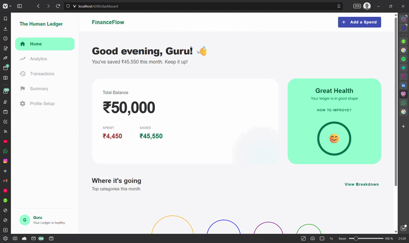
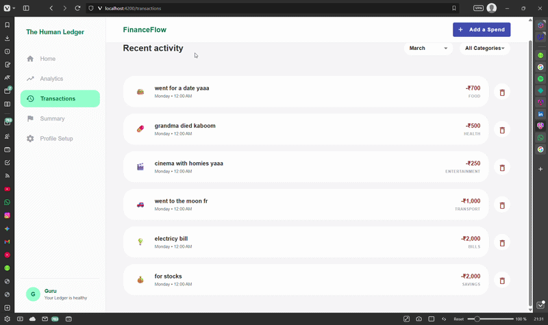
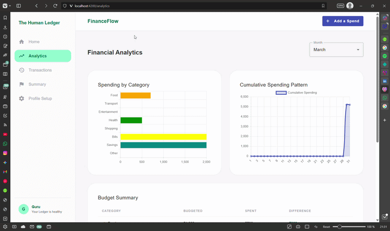
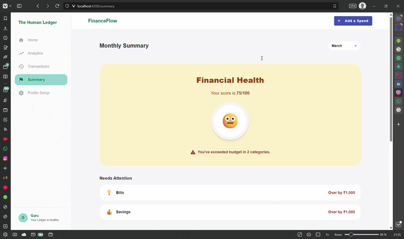
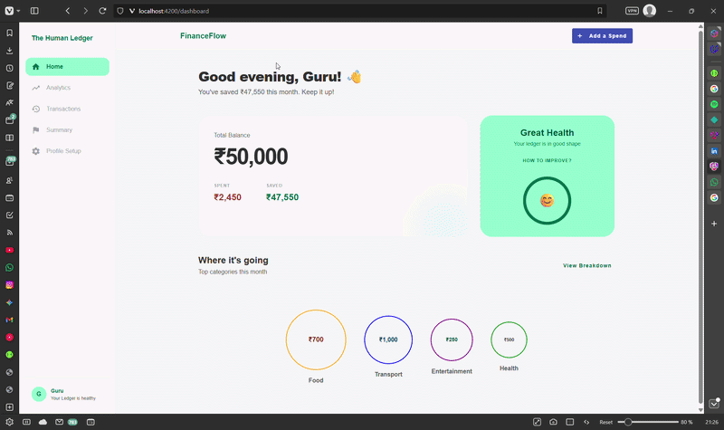

#  FinanceFlow

A personal finance tracker I built to get better at budgeting. You set your monthly salary, split it across categories like food, transport, bills etc., log your expenses as you go, and the app tells you how well you're actually sticking to your plan.

**[Live Demo](https://financeflow24.netlify.app/)**

---

## 📸 Demo

**Onboarding — Set Salary & Budgets**


**Adding an Expense**



**Transactions**



**Analytics — Charts by Month**



**Monthly Summary & Health Score**



**Navigation**



---

##  What it does

- **Setup page** — first thing you do is enter your salary and set a budget for each spending category. You can come back and edit this anytime
- **Dashboard** — shows income, total spent, and how much you've saved this month. Each category has a progress bar so you can see at a glance where you're overspending
- **Add Expense** — log a spend with category, amount, date, and an optional note
- **Transactions** — full list of everything you've logged, with the option to delete any entry
- **Analytics** — a horizontal bar chart showing spending per category, and a cumulative line chart showing how your spending built up over the month. Both are filterable by month and year
- **Monthly Summary** — income vs spent vs saved, plus a health score and a list of categories you've gone over budget on

---

##  Health Score

The health score is a number from 0 to 100. It starts at 100 and drops by ~12.5 points for each category where you've spent more than your budget. So if you've blown your budget in 3 categories, you're sitting at around 62. Hit 0 and you've exceeded every single category — time to reassess.

---

## 🛠️ Tech Stack

| | |
|---|---|
| Framework | Angular 21 |
| Styling | Tailwind CSS 4 + CSS |
| UI | Angular Material 21 |
| Charts | Chart.js 4 + ng2-charts |
| Forms | Angular Reactive Forms |
| Routing | Lazy-loaded standalone components |
| SSR | Angular SSR + Express 5 |
| Storage | localStorage (SSR-safe) |
| Language | TypeScript 5.9 |

---

## Project Structure

```
src/
└── app/
    ├── core/
    │   ├── models/
    │   │   ├── expense.model.ts      # Expense shape (id, category, amount, date, note)
    │   │   └── profile.model.ts      # UserProfile shape (salary, budgets map)
    │   └── services/
    │       ├── expense.service.ts    # All the logic — CRUD, health score, budget calc
    │       └── storage.service.ts    # localStorage wrapper that's safe for SSR
    ├── features/
    │   ├── setup/                    # Onboarding + edit profile
    │   ├── dashboard/                # Monthly overview with category bars
    │   ├── add-expense/              # Expense entry form
    │   ├── transactions/             # Full list with delete
    │   ├── analytics/                # Charts with month/year filter
    │   └── summary/                  # Summary + health score
    └── shared/
        ├── components/
        │   ├── stat-card/            # Reusable card for income/spent/saved
        │   └── category-bar/        # Budget progress bar per category
        └── constants/
            └── categories.ts        # 8 categories with icons and colors
```

---

##  Running locally

```bash
git clone https://github.com/your-username/FinanceFlow.git
cd FinanceFlow
npm install
ng serve
```

App runs at `http://localhost:4200`. On first load it'll redirect you to the setup page since there's no profile yet.

```bash
# Production build
ng build
```

---

##  Things I focused on technically

- All 6 routes are lazy loaded with `loadComponent` — no eager loading at all
- `StorageService` wraps every `localStorage` call behind `isPlatformBrowser` so the SSR build doesn't crash
- Setup page uses Reactive Forms with `FormBuilder` and `Validators` — proper form handling, not template driven
- `ExpenseService` handles all the business logic cleanly — the components just call methods and render
- Charts are driven by Chart.js with `ng2-charts` and update reactively when the month filter changes

---


## Created by Guru

**Gurushankar**
- LinkedIn: [linkedin.com/in/gurushankarv](https://www.linkedin.com/in/gurushankarv)
